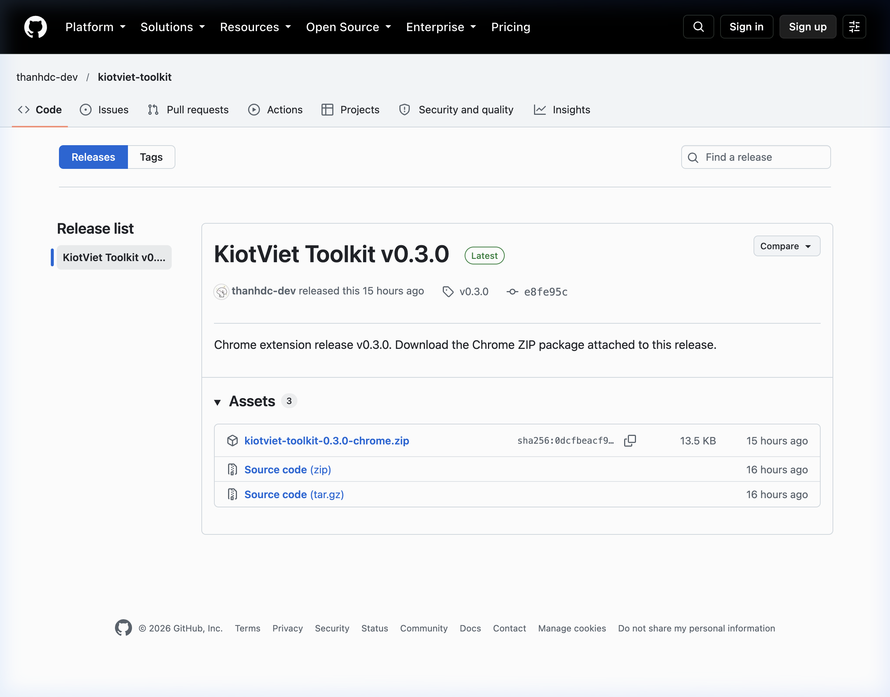
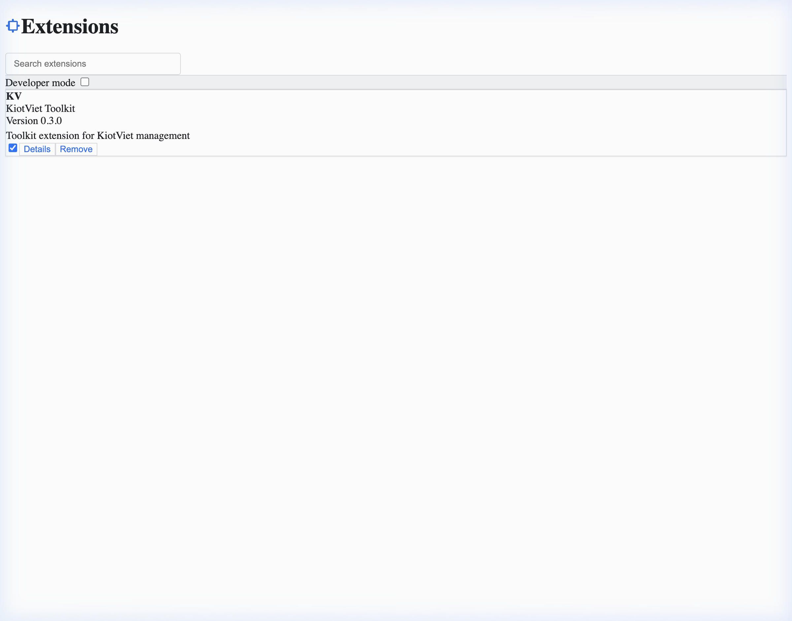
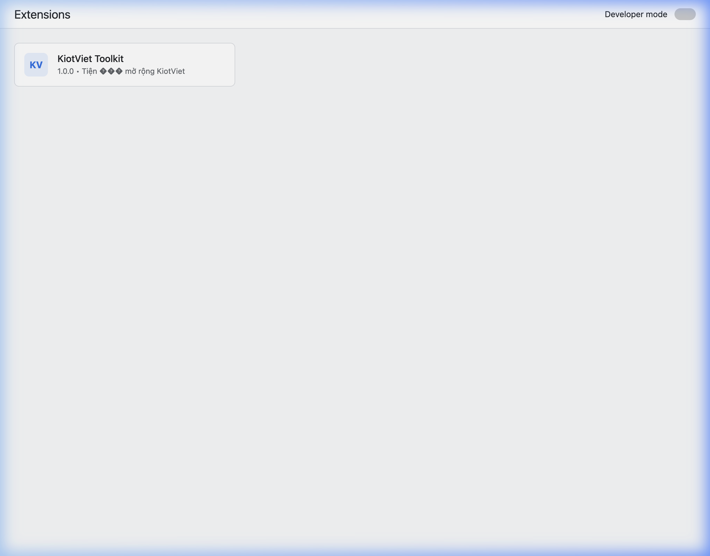
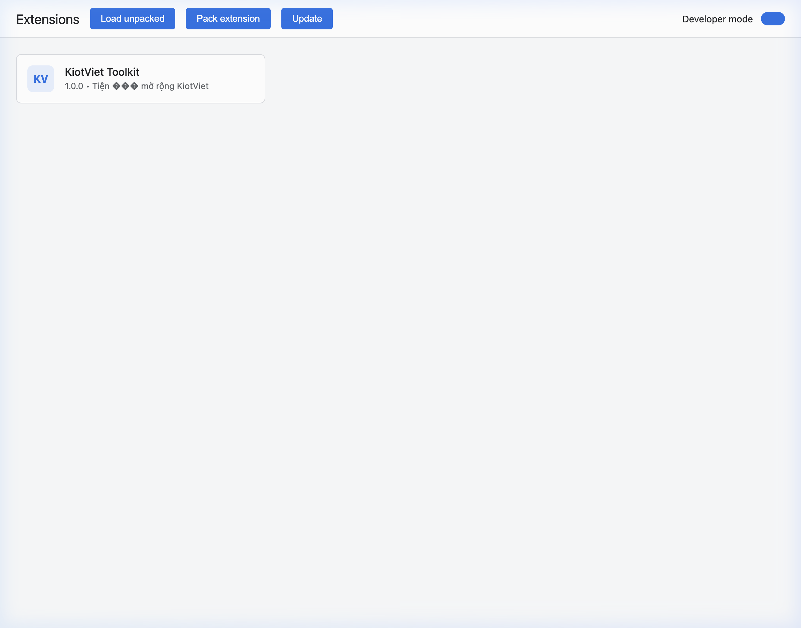

# KiotViet Toolkit

Tiện ích mở rộng Chrome đa năng (Manifest V3, WXT + TypeScript) giúp tối ưu giao diện, bổ trợ tính năng và nâng cao hiệu suất thao tác trên nền tảng quản lý bán hàng `*.kiotviet.vn`.

---

## 🚀 Các tính năng hiện tại

### 1. Định dạng & Hiển thị số điện thoại thông minh
Tự động thêm dấu phân cách cho số điện thoại trên mọi màn hình KiotViet giúp quan sát trực quan, hạn chế sai sót khi đọc hay đối soát:

| Gốc | Hiển thị |
|---|---|
| `0357747884` | `0357 747 884` |
| `+84357747884` | `+84 357 747 884` |
| `02437477884` | `024 3747 7884` |
| `02543747788` | `0254 374 7788` |

- **Bật/tắt định dạng**: Hỗ trợ tuỳ chọn các kiểu phân cách linh hoạt (dấu cách, dấu chấm, gạch ngang).
- **Hiện mọi số của khách**: Tự động trích xuất và hiển thị cả số chính lẫn số phụ của khách hàng ngay trên danh sách (mỗi số một dòng).

---

## 🔮 Định hướng phát triển (Toolkit đa năng)

Dự án được định hướng phát triển thành bộ công cụ all-in-one cho KiotViet với các module dự kiến:
- **Tối ưu trải nghiệm danh sách & dữ liệu**: Mở rộng trích xuất thông tin khách hàng, đối tác, đơn hàng nhanh.
- **Phím tắt & Thao tác nhanh**: Thêm shortcut tiện lợi cho màn hình bán hàng (POS) và quản trị.
- **Tùy biến hiển thị**: Cá nhân hóa giao diện, hỗ trợ highlight trạng thái đơn, tồn kho cảnh báo.
- **Hỗ trợ công việc hàng ngày**: Tích hợp các tiện ích nhỏ phục vụ in ấn, xuất/sao chép nhanh dữ liệu.

## 📦 Hướng dẫn cài đặt

### Yêu cầu hệ thống

| Yêu cầu | Phiên bản tối thiểu |
|---|---|
| Node.js | ≥ 18.0.0 |
| npm | ≥ 9.0.0 |
| Google Chrome | ≥ 88 (Manifest V3) |

> **Kiểm tra phiên bản:** Chạy `node -v && npm -v` trong terminal để xác nhận.

---

### Cách 1: Cài đặt từ Chrome Web Store _(khuyên dùng)_

1. Mở Chrome và truy cập [Chrome Web Store](https://chromewebstore.google.com/).
2. Tìm kiếm **KiotViet Toolkit**.
3. Nhấn **Thêm vào Chrome** → xác nhận **Thêm tiện ích**.
4. Biểu tượng tiện ích xuất hiện trên thanh công cụ — sẵn sàng sử dụng!

---

### Cách 2: Tải file Release & cài thủ công _(không cần build)_

> Phù hợp khi bạn không muốn cài Node.js hoặc build từ source.

#### Bước 1 — Tải file Release

1. Truy cập trang **[Releases](https://github.com/thanhdc-dev/kiotviet-toolkit/releases)** trên GitHub.
2. Chọn phiên bản mới nhất (ví dụ: `v0.3.0`).
3. Trong mục **Assets**, nhấn vào file **`kiotviet-toolkit-*.zip`** để tải về.

   

#### Bước 2 — Giải nén file ZIP

- **Windows**: Chuột phải vào file `.zip` → **Extract All...** → chọn thư mục đích → **Extract**.
- **macOS**: Double-click vào file `.zip` — tự động giải nén cùng thư mục.
- **Linux**: Chạy lệnh `unzip kiotviet-toolkit-*.zip -d kiotviet-toolkit/`

Sau khi giải nén sẽ có thư mục `kiotviet-toolkit/` (hoặc tương tự) chứa các file extension.

#### Bước 3 — Mở trang quản lý Extension trên Chrome

1. Mở **Google Chrome**.
2. Nhập vào thanh địa chỉ: `chrome://extensions` rồi nhấn **Enter**.

   > Hoặc vào **Menu (⋮)** → **More tools** → **Extensions**.

   

#### Bước 4 — Bật Developer Mode

Ở **góc trên bên phải** trang `chrome://extensions`, bật công tắc **Developer mode**.



#### Bước 5 — Nạp extension vào Chrome

1. Nhấn nút **Load unpacked** xuất hiện ở góc trên bên trái.
2. Trong hộp thoại chọn thư mục, điều hướng đến thư mục vừa giải nén.
3. Nhấn **Select Folder** (Windows) / **Open** (macOS).

   

#### Bước 6 — Xác nhận cài đặt thành công

- **KiotViet Toolkit** xuất hiện trong danh sách extension với trạng thái **Enabled** (xanh lá).
- Biểu tượng 🛠 xuất hiện trên thanh công cụ Chrome.
- Truy cập `*.kiotviet.vn` — extension hoạt động ngay!

> [!TIP]
> Sau khi cài, nếu có phiên bản mới: lặp lại **Bước 1–2**, vào `chrome://extensions` → tìm **KiotViet Toolkit** → nhấn **⟳ Update** (hoặc nhấn biểu tượng reload bên cạnh extension).

---

### Cách 3: Cài đặt & Build từ source code

#### Bước 1 — Clone & cài dependencies

```bash
git clone https://github.com/thanhdc-dev/kiotviet-toolkit.git
cd kiotviet-toolkit
npm install
```

#### Bước 2 — Build extension

```bash
npm run build
```

Sau khi build thành công, thư mục `.output/chrome-mv3/` chứa extension đã đóng gói.

#### Bước 3 — Nạp vào Chrome

1. Mở Chrome, truy cập `chrome://extensions`.
2. Bật **Developer mode** (góc trên bên phải).
3. Nhấn **Load unpacked**.
4. Chọn thư mục `.output/chrome-mv3/`.
5. Extension xuất hiện trong danh sách — hoàn tất!

---

### Cách 4: Chạy môi trường phát triển (Dev mode)

```bash
npm install
npm run dev      # mở Chrome với extension, có HMR (Hot Module Replacement)
```

Chế độ dev tự động reload khi có thay đổi code — tiện lợi khi phát triển/test tính năng mới.

---

### Các lệnh hữu ích

| Lệnh | Mô tả |
|---|---|
| `npm run dev` | Chạy dev server, mở Chrome với HMR |
| `npm run build` | Build production vào `.output/chrome-mv3/` |
| `npm run zip` | Đóng gói extension thành file `.zip` để submit lên Web Store |
| `npm run compile` | Kiểm tra kiểu TypeScript (không emit file) |
| `npm test` | Chạy test suite với Vitest |

## Hiện mọi số của khách

KiotViet chỉ đưa số chính vào DOM của danh sách, còn số phụ nằm trong model AngularJS của dòng. Vì vậy có hai phần:

1. `entrypoints/scope-reader.content.ts` chạy ở **MAIN world**. Với mỗi text node trông giống số điện thoại, nó đọc model của dòng chứa nó (chỉ đọc, không sửa) rồi ghi danh sách số vào attribute `data-kvpf-phones` của phần tử cha. Không cần selector theo từng màn hình: chỉ gắn khi số đang hiển thị đúng là số chính trong model.
   - Khách hàng: `dataItem.ContactNumber` + `dataItem.SubNumber`
   - Hóa đơn, đặt hàng: `dataItem.Customer.ContactNumber` + `dataItem.Customer.SubNumber`
2. Content script thường đọc attribute đó, giữ nguyên text node, ghi các số cách nhau bằng `\n` và gắn `data-kvpf-multi` để CSS `white-space: pre-line` hiển thị nhiều dòng. Không thay text node bằng `<br>` thật vì AngularJS vẫn giữ tham chiếu node cũ và sẽ không cập nhật được nữa.

Chỉ tin attribute khi số đang hiển thị trùng số chính của dòng, để không hiện nhầm số của khách cũ khi dòng được tái sử dụng.

**Thêm màn hình mới:** mở Console, chọn ô điện thoại ở màn hình đó rồi chạy đoạn quét scope dưới đây, sau đó thêm một mục vào `SOURCES` trong `lib/scopeReader.ts` (tên thuộc tính scope và đường dẫn các trường số điện thoại, hỗ trợ lồng nhau như `Customer.SubNumber`).

```js
const scope = angular.element($0).scope();
const seen = new WeakSet(), hits = [];
(function scan(obj, path, depth) {
  if (!obj || typeof obj !== 'object' || depth > 4 || seen.has(obj)) return;
  seen.add(obj);
  for (const key of Object.keys(obj)) {
    if (key.startsWith('$')) continue;
    const v = obj[key];
    if (typeof v === 'string' && /0\d{9}/.test(v.replace(/\s/g, ''))) hits.push({ path: `${path}.${key}`, value: v });
    else if (typeof v === 'object') scan(v, `${path}.${key}`, depth + 1);
  }
})(scope, 'scope', 0);
console.table(hits);
```

## Quy tắc

- Chỉ format chuỗi liền bắt đầu bằng `0`, `84` hoặc `+84` và đúng đầu số VN (di động `03/05/07/08/09`, bàn `02x`).
- Chỉ đổi text node có nội dung **trọn vẹn** là một số điện thoại. Chuỗi như `SĐT: 0357747884` hoặc `HD0357747884` được giữ nguyên.
- Không đụng vào `input`, `textarea`, `select`, `contenteditable`.
- Copy ra đúng như hiển thị (có phân cách).

## Cấu trúc

```
entrypoints/content.ts            content script (ISOLATED), matches https://*.kiotviet.vn/*
entrypoints/scope-reader.content.ts  content script (MAIN world) đọc scope AngularJS
entrypoints/popup/       popup bật/tắt + chọn phân cách
lib/formatPhone.ts       hàm thuần định dạng số
lib/walker.ts            duyệt text node + MutationObserver, khôi phục số gốc, hiện nhiều số
lib/scopeReader.ts       đọc model của dòng ở MAIN world, bảng SOURCES theo màn hình
lib/shared.ts            hằng số dùng chung giữa hai world
lib/settings.ts          cấu hình lưu bằng chrome.storage.sync
tests/                   Vitest (formatPhone + walker trên happy-dom)
```

## Cần kiểm tra trên KiotViet thật

- Chiều cao dòng: nếu lưới có chiều cao dòng cố định hoặc virtual scroll, ô nhiều dòng có thể bị cắt hoặc chồng dòng.
- Hiển thị nhiều số cần AngularJS còn bật debug info (`scope()` đọc được). Nếu một danh sách không có cột điện thoại hoặc hiển thị số kèm chữ trong cùng một text node (ví dụ `Tên - 0357...`), nó sẽ không được nhận ra.
- Màn hình bán hàng có nằm ở domain/đường dẫn khác `*.kiotviet.vn` không → bổ sung `matches` nếu có.
- Số bị tách thành nhiều thẻ (`<span>0357</span><span>747884</span>`) hoặc nằm trong shadow DOM sẽ chưa được xử lý.
- Hiệu năng trên bảng lớn và màn hình bán hàng.
